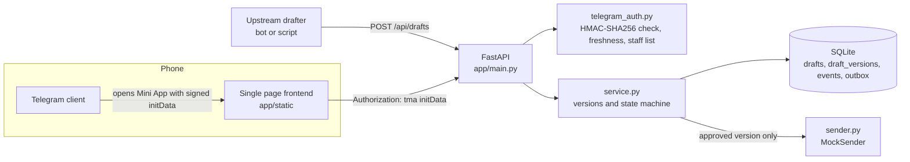
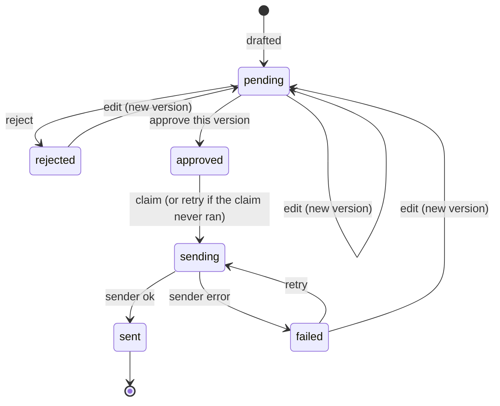

# sms-approval-desk

**A person approves every automated text before it reaches a customer.**

If software drafts texts for your business (appointment reminders, quote follow ups, running late notices), a wrong one cannot be unsent.
This small web app sits between whatever writes the drafts and whatever sends them.
Each draft waits in a queue until a staff member reads the exact wording on their phone and taps Approve, Edit or Reject.

- **Nothing sends without an approval of that exact wording.** An edit becomes a new version and needs a fresh approval.
- **A stale tap is refused.** If a colleague changed the text while you were looking at the old one, your Approve is turned down, not applied to words you never read.
- **One approval, one text.** A double tap, or two people approving at the same moment, hands the text to the sender once.
- **Every decision is on record:** who approved, edited or rejected which version, and when.
- **Staff sign in through Telegram.** The page opens from a bot button as a Telegram Mini App, and only accounts on your staff list get in. No passwords to manage.

**Status: a working reference build, not a deployed product.**
The approval rules, the sign in check and the phone screen are real and tested (116 automated tests, run in CI).
The SMS sender is a mock, and the app has never been connected to a live carrier or opened inside a live Telegram client.
[Limitations](#limitations) lists exactly what is and is not proven.

Built with Python, FastAPI, SQLite and a plain JavaScript page with no build step.

## What you will see

`python demo/run_demo.py` runs the real app offline with two fake reviewers, Robin and Sky. Part of its output, copied from a run:

```
== 4. Robin edits draft 3. The edit becomes version 2 and needs approval
   200 draft 3 -> pending, version 2
   Texts sent so far: 1 (the edit sent nothing)

== 5. Sky still has version 1 on screen and taps Approve
   409 stale_version: You were looking at version 1 but the draft is now at version 2. Reload and review the latest text.

== 6. Robin tries to approve the edit Robin just wrote
   403 second_approver_required: You wrote this version, so someone else has to approve it

== 7. Sky reloads, reads version 2 and approves it
   200 draft 3 -> sent, version 2

== Final counts
   pending: 1, sent: 3, rejected: 1
   Mock sender delivered 3 texts in 4 attempts.
```

The full run is in [`demo/output.txt`](demo/output.txt), and CI repeats it on every push. "Sent" here means handed to the mock sender. No real text is sent anywhere.

## How it works

- **Drafts live in SQLite.** Each has a recipient, a purpose and a body, and starts as `pending`.
- **An edit is a new version.** Text is never changed in place. Editing appends version N+1 and puts the draft back to `pending`. Old versions stay in the history.
- **Every decision names a version.** Approve and Reject carry the version the reviewer was looking at. If the draft has moved on, the server answers `409 stale_version`.
- **Every request is verified.** Each API call carries Telegram's signed init data. The server recomputes the HMAC-SHA256 signature with the bot token, checks freshness, then checks the user against a staff allowlist. There are no sessions.
- **Sending goes through an interface.** Approval hands the text to a sender. The only implementation is `MockSender`, which records what it was asked to send and can simulate a carrier failure. A failed send can be retried without a second approval.
- **Double sends are guarded in the database.** Dispatch claims the draft with a conditional update inside a write transaction and checks the outbox for an earlier delivery first. A test races eight threads on one draft and the sender is called once. A partial unique index also allows at most one `sent` outbox row per draft. A crash in the middle of a send is not covered, see Limitations.
- **Optional second approver rule.** With `REQUIRE_SECOND_APPROVER=true` the person who wrote a version cannot approve it.

## Architecture



Draft states:



| File | Role |
| --- | --- |
| `app/telegram_auth.py` | Init data parsing, signature check, freshness check. Standard library only. |
| `app/service.py` | The approval rules. No HTTP, tested directly. |
| `app/main.py` | FastAPI routes, auth dependency, static frontend. |
| `app/db.py` | Schema and transaction helper for SQLite. |
| `app/sender.py` | `Sender` protocol and `MockSender`. |
| `app/sms.py` | Phone format check and segment estimate (GSM-7 or UCS-2). |
| `app/config.py` | Settings from environment variables, with unsafe combinations refused. |
| `app/seed.py` | Five synthetic drafts. |
| `app/static/` | `index.html`, `app.js`, `styles.css`. No build step. |

### How the signature check works

Telegram gives a Mini App a query string that includes a `hash` field. The server never trusts the other fields until it has recomputed that hash:

```
secret_key        = HMAC_SHA256(key="WebAppData", msg=bot_token)
data_check_string = every field except hash, as key=value, sorted, joined by newlines
expected          = hex(HMAC_SHA256(key=secret_key, msg=data_check_string))
```

The comparison is constant time. The signature is checked first, then `auth_date` (too old or dated in the future is refused), then the `user` JSON. Repeated keys are refused because they make the check string ambiguous. Each failure has its own stable error code (`bad_signature`, `expired`, `missing_hash` and so on).

## Run it

Needs Python 3.10 or newer. No keys and no accounts.

```bash
python -m venv .venv
source .venv/bin/activate        # Windows: .venv\Scripts\activate
pip install -r requirements.txt
python -m app.seed
uvicorn app.main:create_app --factory
```

Open http://127.0.0.1:8000 and narrow the window to phone width. You should see five pending drafts with Reject, Edit and Approve buttons.

Outside Telegram there is no init data, so in `APP_ENV=dev` the page asks `/api/dev/init-data` to sign some for a fake reviewer using the built in fake bot token. The signed string then goes through the same verification as real Telegram data on every request. Tap the name in the top right corner to switch between the two dev reviewers. That endpoint returns 404 when `APP_ENV=prod`. The page also tries to load Telegram's bridge script from telegram.org. Offline that request fails and the page carries on after a short wait.

Configuration is by environment variable. See `.env.example`.

## Tests

```bash
pip install -r requirements-dev.txt
python -m pytest
```

116 tests. They use a temp SQLite file and a fake bot token and make no network calls.

- `tests/test_telegram_auth.py`: a pinned hash vector, an independent recomputation with `hashlib`, tampered fields, a token from another bot, missing or empty hash, repeated keys, expired and future dated data, malformed user JSON, a junk hash that must be refused and not crash.
- `tests/test_service.py`: versioning, stale decisions, reject and reopen, failed send and retry, the double delivery guards (including eight threads approving one draft at once), the second approver rule.
- `tests/test_api.py`: every route refuses unsigned requests, the staff allowlist, the full edit then approve flow over HTTP, the error format, the dev helper being absent in prod.
- `tests/test_sms_and_config.py`: segment counting, phone format, unsafe configuration being refused.

CI (`.github/workflows/ci.yml`) runs the tests and the demo on Python 3.10 and 3.12 on every push.

## Demo

```bash
python demo/run_demo.py
```

The demo starts the real app in process against a throwaway database and plays two fake reviewers through the whole story: unsigned and forged requests being refused, an approval, an edit that becomes version 2, a stale approval being refused, the second approver rule, a rejection, a carrier failure with a retry, and a second Approve tap on a sent draft being refused. The captured output is in [`demo/output.txt`](demo/output.txt), with an excerpt under [What you will see](#what-you-will-see).

All names, phone numbers and messages in the seed data, tests and demo are invented. Phone numbers use the 555-01xx range reserved for fiction.

## API

All routes except `/api/health` and the dev helper need `Authorization: tma <initData>`.

| Method and path | Purpose |
| --- | --- |
| `GET /api/health` | Liveness. |
| `GET /api/me` | The signed in reviewer and counts per status. |
| `GET /api/drafts?status=pending` | List drafts with their current text. |
| `POST /api/drafts` | Create a draft (`recipient_name`, `recipient_phone`, `body`, `purpose`). |
| `GET /api/drafts/{id}` | One draft with all versions and the event history. |
| `POST /api/drafts/{id}/edit` | `{body, base_version}`. Appends a version, back to pending. |
| `POST /api/drafts/{id}/approve` | `{version}`. Approves that version and sends it. |
| `POST /api/drafts/{id}/reject` | `{version, reason}`. |
| `POST /api/drafts/{id}/retry` | Retry a failed send, or send an approved draft whose send never started. |
| `GET /api/outbox` | Every send attempt handed to the sender. |
| `GET /api/dev/init-data?user=1001` | Dev only. Signs init data for a fake reviewer. |

Errors from the API routes look like `{"error": {"code": "stale_version", "message": "..."}}`, including request validation errors (`invalid_request`). Interactive API docs are at `/api/docs`.

## Where this pattern runs

This is drawn from systems that run two small service companies day to day, where software drafts routine customer texts (reminders, follow ups, running late notices) and a person on the team approves each one from their phone before it goes out. The code here is a clean rewrite of the pattern with synthetic data. It shares no code, data or configuration with those systems.

## Limitations

What is mocked or unproven:

- **No real SMS provider.** Only `MockSender` exists, it never opens a socket, and configuration refuses any other provider name. No text has ever been sent by this code. Wiring a carrier means writing one class with a `send(to_phone, body)` method, plus delivery receipts, which are not modelled at all.
- **Never run inside real Telegram.** The signature check follows Telegram's documented algorithm and is tested with fake tokens and vectors computed independently in the tests. It has not been exercised against init data produced by a live Telegram client. The newer Ed25519 `signature` field for third party validation is not checked (it is only treated as one more signed field).
- **No bot.** There is no Telegram bot that posts the "open desk" button or notifies staff about new drafts. You would point a bot's Mini App URL at this server yourself.
- **The upstream drafter is not here.** Nothing in this repository writes drafts except the seed script and the demo. `POST /api/drafts` uses the same staff auth as everything else. A real deployment would add a separate service credential for the system that writes drafts.
- **Never deployed.** It has only run on a developer machine and in CI. There is no Dockerfile, HTTPS setup, backup or monitoring.

Known gaps in the design:

- **A crash mid send needs a human.** If the process dies after the sender was called but before the result was recorded, the draft stays in `sending`. Nothing sweeps it and no API route moves it, on purpose, because retrying blindly could send twice. Fixing it means editing the database by hand after checking with the carrier. A draft that stopped one step earlier, in `approved`, can be sent with the retry route.
- **The send once guard is local.** It stops this app from calling the sender twice for one draft. It does not pass an idempotency key to a carrier, and the unique index is checked when the result is recorded, after the sender call.
- **Init data is replayable until it expires.** Anyone who captures a valid init data string can use it for `INIT_DATA_MAX_AGE_SECONDS` (one hour by default). That is how the Telegram scheme works. Serve over HTTPS and keep the window short.
- **Single node.** SQLite with one writer at a time is fine for a handful of reviewers and not for more. The concurrency test uses eight threads in one process, which is not a load test. No migrations tool, just `CREATE TABLE IF NOT EXISTS`.
- **No scheduling, quiet hours, opt out handling or rate limits.** Those belong in front of a real sender and are not here.
- **Segment counts are an estimate** for the reviewer, not a billing figure. Characters that take two units are not kept from straddling a segment boundary, so a long text can be undercounted by one segment.
- **The frontend has no automated tests.** It was checked by hand in a browser at phone width (the draft list and an approval). The tests cover the backend and that the static files are served.
- **Dependencies are version ranges, not a lock file.** Local runs were on Python 3.12 on Windows. Python 3.10 and Linux are covered by CI only.

License: MIT, see the LICENSE file.
